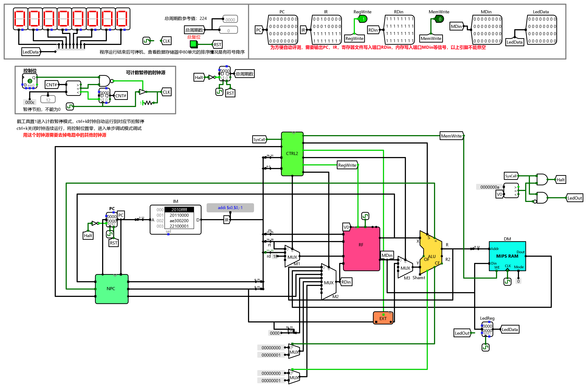
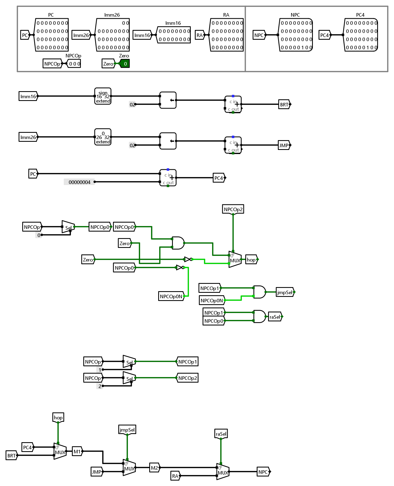
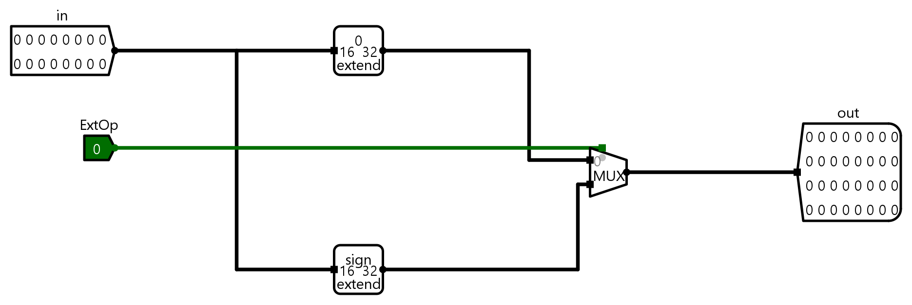
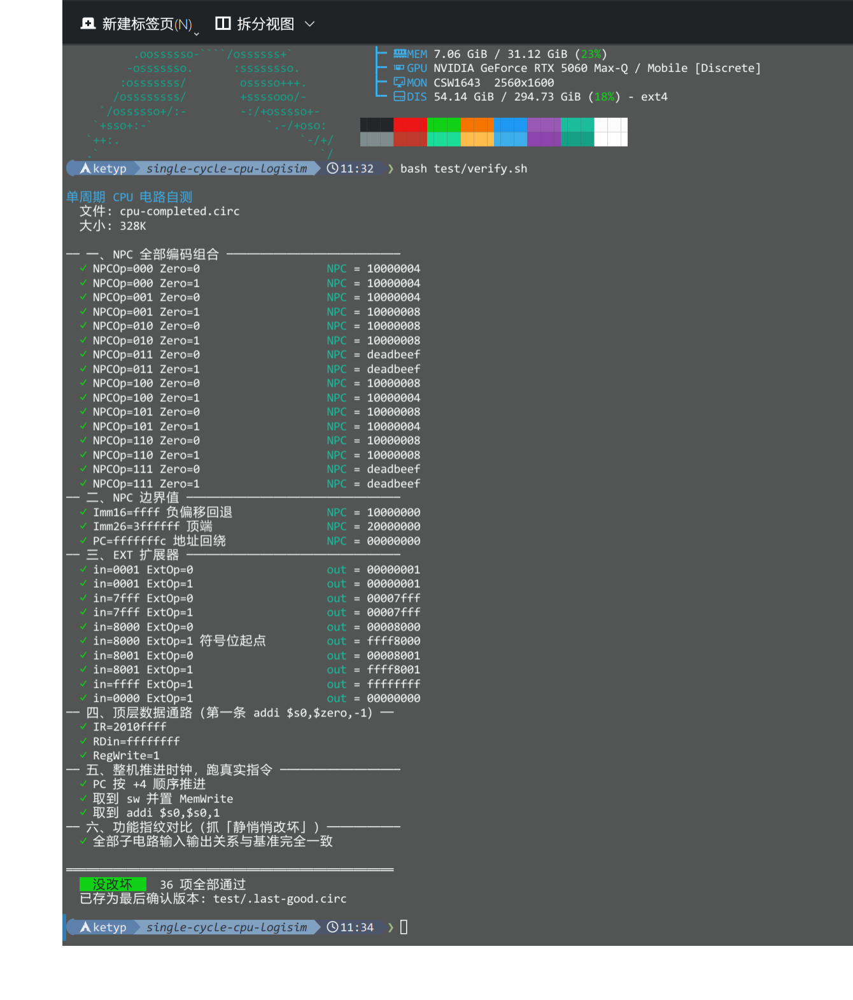

# MIPS 单周期处理器设计实验 · Logisim

> **计算机组成原理实验三：MIPS 单周期处理器设计（Logisim）—— 数据通路、硬布线控制器 GCN/GCS、NPC 次地址计算单元、EXT 扩展单元**
> Single-cycle MIPS CPU in Logisim: datapath, hardwired control unit, next-PC unit.

用 Logisim 手工搭建的 MIPS 单周期处理器：14 条指令、硬布线控制器、配套一套可反复运行的自动测试。
模板自带的冒泡排序程序跑完 **224 个周期**，与参考值一致；自检脚本 36 项全过。



电路全部用 Logisim 原生元件绘制，没有生成脚本。数据通路横向单向流动，
控制逻辑分区摆放，跨区连线用 Tunnel 标名而不是拉长线横穿版面。

```
指令存储器 → 指令寄存器 → 控制单元 ─┐
      ↑                              ├→ 寄存器堆 → ALU → 数据存储器 → 写回
      └──────── NPC ←── 分支/跳转判断 ┘
```

---

## 准备依赖

三个文件由课程/第三方提供，**版权归原作者，不随本仓库分发**，需要自己从课程资料拿到后放到指定位置：

| 文件 | 放到 | 说明 |
|---|---|---|
| `logisim.jar` | `simulator/logisim.jar` | Logisim 2.15 定制版（带 LED、探针元件）。**原版 Logisim 打不开本电路** |
| `cs3410.jar` | `circuits/cs3410.jar` | 元件库，电路文件按文件名引用 |
| `mips-probe.jar` | `circuits/mips-probe.jar` | 元件库：探针、LED，电路文件按文件名引用 |

放好之后 `bash test/verify.sh` 会自动检测，缺哪个直接告诉你缺哪个。这三个路径已写进 `.gitignore`，
不会被误提交。

> **`circuits/` 里的 `.jar` 和两个子电路 `.circ` 不要挪走，也不要改名。**
> Logisim 解析电路文件中的 `jar#cs3410.jar`、`file#storage_DM_wjz.circ` 这类引用时，
> 是以**该 `.circ` 文件所在目录**为基准的。搬进 `lib/` 之类的目录，电路就打不开了。

---

## 目录结构

```
single-cycle-cpu-logisim/
├── circuits/
│   ├── cpu-completed.circ     成品电路（14 条指令全部实现）
│   ├── cpu-template.circ      课程空模板，NPC 与 EXT 未实现（课程随附）
│   ├── storage_DM_wjz.circ    数据存储器子电路，被主电路硬引用（课程随附）
│   ├── alu_wjz_BUAA.circ      ALU 子电路，被主电路硬引用（课程随附）
│   └── *.jar                  元件库，需自行放入，见「准备依赖」
├── docs/
│   ├── testing.md             测试方法、覆盖范围与局限
│   └── images/                电路截图、测试输出截图
├── simulator/
│   └── logisim.jar            Logisim，需自行放入，见「准备依赖」
└── test/
    ├── verify.sh              36 项自动测试（主入口）
    ├── build.sh               编译 Java 测试工具
    ├── baseline.txt           功能指纹基准
    └── *.java                 测试工具源码
```

---

## 快速开始

### 环境

**JDK 8 或更高版本**（`java -version` 和 `javac -version` 都要能输出）。
`.class` 不进版本库，`verify.sh` 首次运行会自动调 `build.sh` 编一次，字节码目标固定为 Java 8，
所以用 JDK 8 / 11 / 17 / 21 / 25 编出来的东西在任何 JDK 8+ 上都能跑。

### 打开电路

```bash
java -jar simulator/logisim.jar circuits/cpu-completed.circ
```

Windows 下双击 `simulator/logisim.jar` 也能开，再从菜单里打开 `.circ`。

### 一键自测

```bash
bash test/verify.sh
```

```
═════════════════════════════════════════════════
    没改坏    36 项全部通过
```

失败会标出期望值和实际值，并提示可能的原因。`bash test/verify.sh 任意/改版.circ` 可以测你自己改的版本。

### 跑完整个程序

模板里烧了一段冒泡排序，跑完应当是 **224 个周期**：

```bash
java -cp "simulator/logisim.jar:test" \
     Run "circuits/cpu-completed.circ" "单周期MIPS CPU" 3000
```

```
总周期数(指令数) = 224
停在 PC          = 00000098
```

**Windows（cmd / PowerShell）** 下把分隔符换成 `;`，路径用反斜杠：

```bat
java -cp "simulator\logisim.jar;test" Run "circuits\cpu-completed.circ" "单周期MIPS CPU" 3000
```

**为什么 224 是个可靠的判据**：单周期 CPU 一条指令占一个周期，程序恰好 224 条指令。
PC 一旦跑飞、陷入死循环、或者提前停机，这个数立刻就不对。它是对整条数据通路
（取指 → 译码 → 执行 → 访存 → 写回）最严格的一次端到端检查。

---

## 实验内容

按指导书，实验分四步。仓库里对应的电路：

| 指导书要求 | 电路 | 状态 |
|---|---|---|
| 完成 NPC 次地址计算单元并进行测试 | `NPC` | 已完成 |
| 完成控制器 CTRL 设计，得到控制信号表与布尔表达式 | `CTRL2`（`GCN` + `GCS`） | 已完成 |
| 完成 EXT 扩展单元并进行测试 | `EXT` | 已完成 |
| 分析单周期 MIPS CPU 数据通路 | — | 见下文「电路实现」 |

其余部件 —— `IM`（指令存储器）、`Splitter`（指令拆分）、`RF`（寄存器堆）、
`ALU`（算术逻辑单元）、`DM`（数据存储器）—— 由指导书随附的模板给出，直接使用。

**实验目的**（引自指导书）

1. 掌握硬布线控制器设计的基本原理，掌握控制信号的分析。
2. 利用 Logisim 平台中已给出的 MIPS 单周期处理器，掌握各个元器件的应用原理。

---

## 电路实现

### 支持的指令（14 条）

| 类型 | 指令 | opcode / funct |
|---|---|---|
| 算术逻辑 | `add` `sub` `slt` `sltu` | op=0x00，funct=0x20 / 0x22 / 0x2a / 0x2b |
| 立即数 | `addi` `ori` `lui` | 0x08 / 0x0d / 0x0f |
| 访存 | `lw` `sw` | 0x23 / 0x2b |
| 分支 | `beq` `bne` | 0x04 / 0x05 |
| 跳转 | `j` `jal` `jr` | 0x02 / 0x03 / funct=0x08 |
| 系统 | `syscall` | funct=0x0c |

### 控制信号

控制器是层次化实现：`GCN`（指令译码，输出 14 个"当前是哪条指令"的信号）
加 `GCS`（把译码信号组合成各控制位）。写成布尔表达式就是：

```
NPCOp[2] = BNE
NPCOp[1] = JR + JAL
NPCOp[0] = JR + BEQ

RFWr     = ADD + SUB + ORI + ADDI + LW + JAL + LUI + SLTU + SLT
DMWr     = SW
Halt     = SYSCALL

EXTOp    = SW + LW + ADDI + ~ORI
ALUOp[1] = ORI
ALUOp[0] = SLT + SLTU + BNE + BEQ + ORI + SUB

BSel[1]  = 0
BSel[0]  = SW + LW + ADDI + ORI

WRSel[1] = JAL
WRSel[0] = SLT + SLTU + SUB + ADD

WDSel[2] = SLT + SLTU
WDSel[1] = LUI + JAL
WDSel[0] = SLTU + LUI + LW
```

`EXTOp = SW + LW + ADDI + ~ORI` 这条容易写错：`ori` 做零扩展，其余需要立即数的指令都是符号扩展，
所以取反项不能漏。

### NPC（次地址计算单元）

四条候选路径，三级 Mux 选出：

```
PC4    = PC + 4
BRT    = PC4 + (sext(Imm16) << 2)      beq / bne 的目标
JMP    = PC4 + (zext(Imm26) << 2)      j / jal 的目标

hop    = NPCOp[2] ? ~Zero : (NPCOp[0] & Zero)
jmpSel = NPCOp[1] & ~NPCOp[0]          只有 010 为 1
raSel  = NPCOp[1] &  NPCOp[0]          只有 011 为 1

I1  = hop    ? BRT : PC4
I2  = jmpSel ? JMP : I1
NPC = raSel  ? RA  : I2
```

`hop` 用一个 Mux 同时覆盖两种分支：`beq`（NPCOp=001）看 `Zero`，`bne`（NPCOp=100）看 `~Zero`。
写成 `NPCOp[0] & (Zero ^ NPCOp[2])` 是错的 —— 在 `NPCOp=100` 上会算成 0，`bne` 永不跳转。



### EXT（扩展单元）

零扩展（`ori`，高 16 位补 0）和符号扩展（其余，复制第 15 位）并排两个 Bit Extender，
由一个 Mux 按 `ExtOp` 选择。注意 **`ExtOp=0` 必须接 Mux 的 In0**（即零扩展放上面），接反了
`addi $s0,$zero,-1` 会得到 `0x0000ffff` 而不是 `0xffffffff`。



### 写回通路

`WDSel` 从四个来源里选一个：ALU 结果 / 存储器读出的数据 / LUI 拼好的常数 / JAL 的返回地址（PC+4）。
选择信号是 3 位（`WDSel[2:0]`），上表里 `SLT`、`SLTU` 单独占一位是为了走比较结果。
`WRSel` 选写哪个寄存器：`rt`（`lw`、`addi` 这类）还是 `rd`（R 型）还是 `$ra`（`jal`）。

---

## 测试

`bash test/verify.sh` 不开图形界面，直接用 Logisim 的 Java API 加载 `.circ`、给引脚赋值、
读输出、逐位比对，六节共 **36 项**：

| 节 | 检查内容 | 项数 |
|---|---|---|
| 一 | NPC 全部编码组合：`NPCOp` 000~111 × `Zero` 0/1 | 16 |
| 二 | NPC 边界值：`Imm16` 负偏移、`Imm26` 顶端、PC 回绕 | 3 |
| 三 | EXT：零扩展 / 符号扩展，含 `0x8000` 符号位起点 | 10 |
| 四 | 顶层数据通路：第一条 `addi $s0,$zero,-1` 的 IR / RDin / RegWrite | 3 |
| 五 | 整机推进 10 拍：PC 按 +4 前进，取到 `sw`、`addi` 并正确置写使能 | 3 |
| 六 | 功能指纹：8 个子电路的输入输出关系与基准逐行比对 | 1 |



**功能指纹**是这套测试里最有用的一环：前五节是硬编码期望值，只覆盖 NPC / EXT / 顶层；
如果改的是 `CTRL2`、`RF`、`GCN` 这些没写死用例的子电路，前五节一个都查不出来。
指纹对每个子电路 dump 一份「输入 → 输出」表，与 `baseline.txt` 逐行 diff ——
**改版式（拖元件、走线、加 Tunnel）指纹完全不变，拖断一根线则整片输出全变。**

测试环境、完整方法、以及"这套测试证明不了什么"，见 **[docs/testing.md](docs/testing.md)**。

---

## 已知限制

1. **模板程序只用到 8 条指令**。那段冒泡排序用了 `addi / lw / sw / add / slt / beq / bne / syscall`，
   而 `sub / ori / lui / sltu / jal / jr` 一次都没执行。所以 "224 周期通过" 证明不了这 6 条指令的
   控制信号接对了 —— 那部分的正确性由控制器穷举测试单独保证。

2. **`CTRL` 是死代码**。模板里还有一个用比较器门级搭出来的 `CTRL` 子电路，但顶层实际实例化的是
   `CTRL2`（GCN + GCS 层次化版本）。`CTRL` 单独测试时译码信号恒为 `x`，是模板原样，
   与本仓库的实现无关，也不影响整机；本仓库的控制器指的是 `CTRL2`。

3. **测试脚本只有 bash 版**。Linux / macOS / WSL / Git Bash 直接跑；纯 Windows 的 cmd 和 PowerShell
   需要手动执行上面给出的 `java` 命令（classpath 分隔符用 `;`）。

---

## 第三方材料与许可

MIT（见 [LICENSE](LICENSE)）只覆盖本人独立完成的部分：`circuits/cpu-completed.circ` 里新增的
`NPC` / `EXT` 子电路与 `CTRL2` 控制器、`test/`、`docs/`。

**不适用 MIT** 的是课程随附材料：`circuits/` 下的 `cpu-template.circ`、`alu_wjz_BUAA.circ`、
`storage_DM_wjz.circ` 三个文件都来自课程分发的压缩包，不是本人作品（文件名里的 `wjz`、`BUAA`
是原作者标记）；后两个被主电路以 `file#` 硬引用，删掉电路就打不开，所以一并保留。
Logisim、`cs3410.jar`、`mips-probe.jar`、指导书与指令集手册同样归原作者所有，且不随仓库分发。

完整的来源、许可与放置路径见 [NOTICE](NOTICE)。
